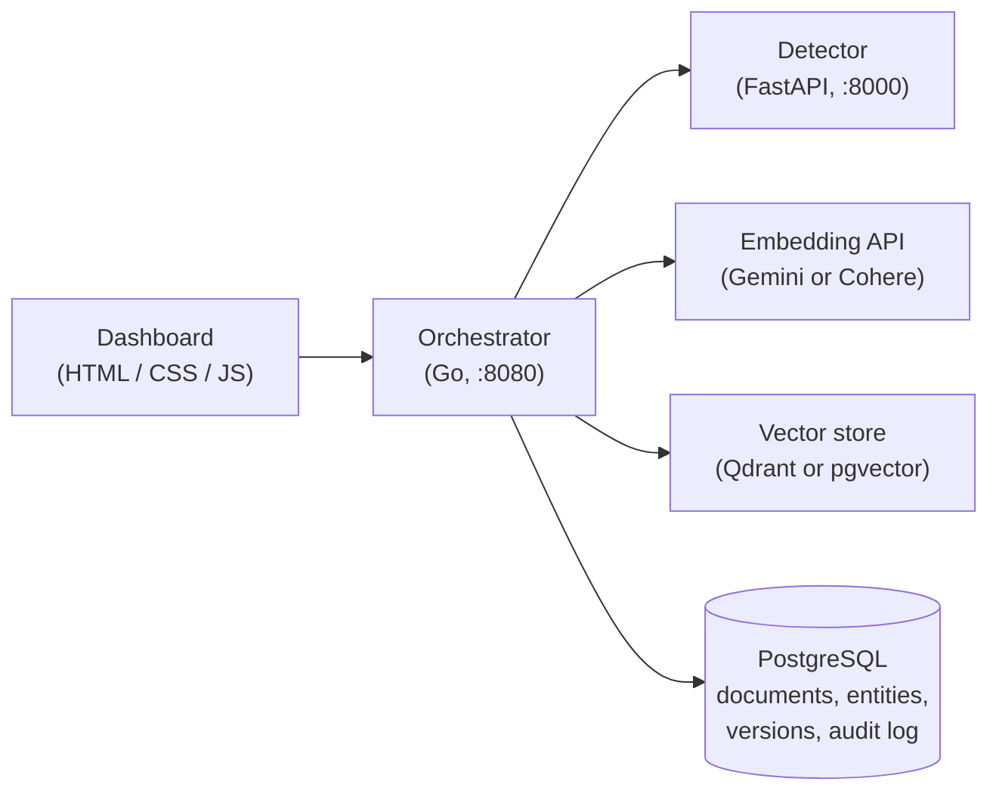

# Pre-Embed DLP

**A PII-sanitizing middleware for RAG pipelines. It detects and redacts personal data in documents *before* they are converted into vector embeddings.**


---

## Table of contents

- [Overview](#overview)
- [How it works](#how-it-works)
- [Features](#features)
- [Tech stack](#tech-stack)
- [Repository structure](#repository-structure)
- [Getting started](#getting-started)
- [Using the dashboard](#using-the-dashboard)
- [API reference](#api-reference)
- [Design notes](#design-notes)
- [Requirements coverage](#requirements-coverage)
- [Troubleshooting](#troubleshooting)

---

## Overview

Organizations are building internal AI assistants (RAG chatbots) on documents such as HR files, support tickets and contracts. These documents contain personally identifiable information (PII). If they are embedded as-is, the assistant can retrieve and display an SSN or a name to anyone who asks the right question.

Pre-Embed DLP adds the missing step to the ingestion pipeline. It sits between document extraction and embedding: a document goes in, sanitized text comes out, and only the sanitized text is embedded and stored.

The project also ships a side-by-side demo that asks the same question of an unprotected and a protected collection, so the leak and the fix can be seen directly.

## How it works



**Ingestion flow**

1. The orchestrator sends the document text to the detector.
2. The detector returns the detected entities (type, position, value).
3. Each entity is replaced with a placeholder such as `[SSN]` or `[NAME]`.
4. The sanitized text is split into 500-character chunks, embedded, and stored in the selected vector store.
5. Detected entities, the sanitized version, and an audit entry are saved in PostgreSQL.

**Detection layers** (`detector/main.py`)

| Layer | Detects | Notes |
|---|---|---|
| Regular expressions | SSN (`###-##-####`), email, phone number | Rule matches take priority over NLP matches when spans overlap |
| Checksum validation | Credit card numbers (13-19 digits) | Only flagged if the number passes the Luhn check |
| NLP (spaCy `en_core_web_sm`) | Person names, locations, organizations | Loaded once at startup and shared across requests |

## Features

- **Pre-embedding sanitization:** PII is replaced before any text reaches an embedding model or vector store.
- **Pluggable vector stores:** Qdrant and pgvector, selectable from a dropdown.
- **Pluggable embedding models:** Gemini (`gemini-embedding-001`) and Cohere (`embed-english-v3.0`), selectable from a dropdown. Both are configured for 1024-dimensional vectors.
- **Selective re-indexing:** re-process a single document without rebuilding the knowledge base. Old vectors are deleted, the new sanitized text is stored, and the document version is incremented.
- **Data subject requests:** find every document that mentions a given name and delete its vectors.
- **Protected vs. unprotected demo:** compare retrieval results from a raw collection and a sanitized collection.
- **Audit trail:** ingestions, re-indexes and data requests are recorded in the `audit_log` table.

## Tech stack

| Component | Technology |
|---|---|
| Orchestration service | Go (standard library `net/http`, `lib/pq`) |
| Detection service | Python, FastAPI, spaCy |
| Relational database | PostgreSQL 16 with the pgvector extension |
| Vector databases | Qdrant (REST API) and pgvector |
| Embedding providers | Google Gemini API, Cohere API |
| Frontend | Plain HTML, CSS and JavaScript (no framework) |
| Packaging | Docker and Docker Compose |

## Repository structure

```
pre-embed-dlp/
├── detector/                # Python FastAPI detection service
│   ├── main.py
│   ├── requirements.txt
│   └── Dockerfile
├── orchestrator/            # Go orchestration service
│   ├── main.go              # HTTP endpoints and pipeline
│   ├── interfaces.go        # EmbeddingProvider and VectorStore interfaces
│   ├── embedders.go         # Gemini and Cohere adapters
│   ├── vectorstores.go      # Qdrant and pgvector adapters
│   ├── schema.sql           # PostgreSQL schema
│   └── Dockerfile
├── frontend/                # Static dashboard
│   ├── index.html           # Landing page
│   ├── ingest.html
│   ├── documents.html
│   ├── requests.html
│   ├── demo.html
│   ├── style.css
│   └── app.js
├── docker-compose.yml
└── README.md
```

## Getting started

### Prerequisites

- [Docker Desktop](https://www.docker.com/products/docker-desktop/) (Docker Compose v2)
- [Git](https://git-scm.com/)
- A [Gemini API key](https://aistudio.google.com/apikey) and a [Cohere API key](https://dashboard.cohere.com)
- A way to serve static files, for example the VS Code **Live Server** extension

### 1. Clone the repository

```bash
git clone https://github.com/<your-username>/pre-embed-dlp.git
cd pre-embed-dlp
```

### 2. Configure environment variables

Create a file named `.env` in the repository root (it is git-ignored and must never be committed):

```env
GEMINI_API_KEY=your-gemini-key
COHERE_API_KEY=your-cohere-key
DATABASE_URL=postgres://postgres:dev@db:5432/dlp?sslmode=disable
QDRANT_URL=http://qdrant:6333
DETECTOR_URL=http://detector:8000
```

| Variable | Purpose |
|---|---|
| `GEMINI_API_KEY` | Authenticates calls to the Gemini embedding API |
| `COHERE_API_KEY` | Authenticates calls to the Cohere embedding API |
| `DATABASE_URL` | PostgreSQL connection string (host `db` is the Compose service name) |
| `QDRANT_URL` | Qdrant REST endpoint |
| `DETECTOR_URL` | Detection service endpoint |

### 3. Start the services

```bash
docker compose up --build
```

The first build takes longer because the spaCy model and the Go toolchain are downloaded. Wait until the log shows `orchestrator listening on :8080`.

| Service | Port | Purpose |
|---|---|---|
| `db` | 5432 | PostgreSQL with pgvector |
| `qdrant` | 6333 | Qdrant (dashboard at `http://localhost:6333/dashboard`) |
| `detector` | 8000 | Detection API (docs at `http://localhost:8000/docs`) |
| `orchestrator` | 8080 | Main API |

### 4. Create the database schema

The schema is applied with a single command. In a second terminal, from the repository root:

**PowerShell (Windows)**
```powershell
Get-Content orchestrator\schema.sql | docker compose exec -T db psql -U postgres -d dlp
```

**macOS / Linux**
```bash
docker compose exec -T db psql -U postgres -d dlp < orchestrator/schema.sql
```

### 5. Open the dashboard

Serve the `frontend/` folder and open `index.html`. With VS Code Live Server: right-click `frontend/index.html` and choose **Open with Live Server**.

> The frontend calls the API at `http://localhost:8080` (set in `frontend/app.js`).

> **Note on test data:** sanitized text is sent to the selected embedding API, and the unprotected demo sends the original text. Use synthetic data (invented names and SSNs) when running the demo.

## Using the dashboard

| Page | What it does |
|---|---|
| **Ingest** | Paste a document, choose the vector store and embedding model, and ingest it. Optionally store an unsanitized copy for the demo. |
| **Documents** | List documents with their version and status. Re-index one by pasting its text again. |
| **Data requests** | Enter a name to delete the vectors of every document that mentions it. |
| **Leak demo** | Ask one question of the unprotected and protected collections side by side. |

**Suggested walkthrough**

1. Open **Ingest**, keep the defaults and ingest the sample text with the checkbox ticked. The response shows the sanitized text with placeholders.
2. Open **Leak demo** and ask the question. The unprotected panel shows the raw value; the protected panel shows a placeholder.
3. Open **Documents** and re-index the document with new text. The version increases to 2.
4. Open **Data requests** and enter a name from the document. The document's vectors are removed from the protected collection.

Use the **same vector store and embedding model** on every page. Vectors from different models are not comparable, and each combination has its own collections.

## API reference

Base URL: `http://localhost:8080`. Valid values: `store` = `qdrant` | `pgvector`, `embedder` = `gemini` | `cohere`.

| Method | Endpoint | Parameters | Body | Description |
|---|---|---|---|---|
| `POST` | `/ingest` | `store`, `embedder`, `name` | Document text | Detect, sanitize, chunk, embed and store. Returns the document ID, entity count, chunk count and sanitized text. |
| `POST` | `/ingest-raw` | `store`, `embedder` | Document text | Embed and store the text **without sanitizing**, in the unprotected collection (demo only). |
| `POST` | `/reindex/{id}` | `store`, `embedder` | Document text | Delete the document's vectors, re-sanitize, re-embed and store, and increment the version. |
| `POST` | `/dsr` | `store`, `embedder`, `name` | none | Delete the vectors of all documents whose detected entities match the name. |
| `GET` | `/ask` | `q`, `collection`, `store`, `embedder` | none | Return the top 3 matching chunks. `collection` = `protected` or `unprotected`. |
| `GET` | `/documents` | none | none | List documents (ID, name, version, status). |

**Example (PowerShell)**

```powershell
curl.exe -X POST "http://localhost:8080/ingest?store=qdrant&embedder=gemini&name=demo" -d "John Smith SSN is 123-45-6789"
```

The response includes the sanitized text, with detected values replaced by placeholders such as `[NAME]` and `[SSN]`.

## Design notes

- **Interfaces, not vendors.** The pipeline depends on two Go interfaces, `EmbeddingProvider` and `VectorStore` (`orchestrator/interfaces.go`). Adding a provider means adding one adapter and one entry in the selector function; the pipeline code does not change.
- **Collections.** Vectors are stored in collections named `protected_<embedder>` and `unprotected_<embedder>`, so vectors from different models never mix.
- **Vector size.** Both embedding adapters produce 1024-dimensional vectors, matching the `vector(1024)` column in `schema.sql` and the Qdrant collection size.
- **Originals are not stored.** Only sanitized text is persisted. This is why re-indexing requires the document text to be supplied again.
- **Relational schema.** `documents`, `entities`, `document_versions`, `audit_log`, and `pg_chunks` (the pgvector store).

## Requirements coverage

| Requirement | How it is met |
|---|---|
| FR1: Vector store selection | Qdrant and pgvector adapters, selectable from a dropdown |
| FR2: Embedding provider selection | Gemini and Cohere adapters, selectable from a dropdown |
| FR3: Selective re-indexing | Re-process a single document; old vectors are deleted and the new sanitized result is stored |
| FR3.3: Version history | Every version is retained in `document_versions` |
| FR4: Data subject request | Locate documents by name and delete their vectors |
| FR5: Protected vs. unprotected demo | Side-by-side retrieval on the Leak demo page |
| NFR1: Docker Compose, no vendor dependency | All services start with `docker compose up` |

## Troubleshooting

| Symptom | Likely cause and fix |
|---|---|
| `Failed to fetch` in the dashboard | The backend is not running. Start it with `docker compose up` and wait for `orchestrator listening on :8080`. |
| `429` error from an embedding call | Embedding API rate limit. Wait a minute and retry. |
| `relation "documents" does not exist` | The schema has not been applied. Run [step 4](#4-create-the-database-schema). |
| `/ask` returns no results | Ingest a document first, and use the same store and embedding model on both pages. |
| Docker build fails with `go.mod requires go >= ...` | The `orchestrator/Dockerfile` must contain `ENV GOTOOLCHAIN=auto` after the first `FROM` line. |
